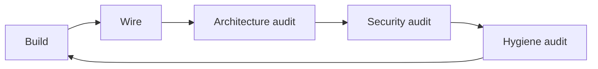
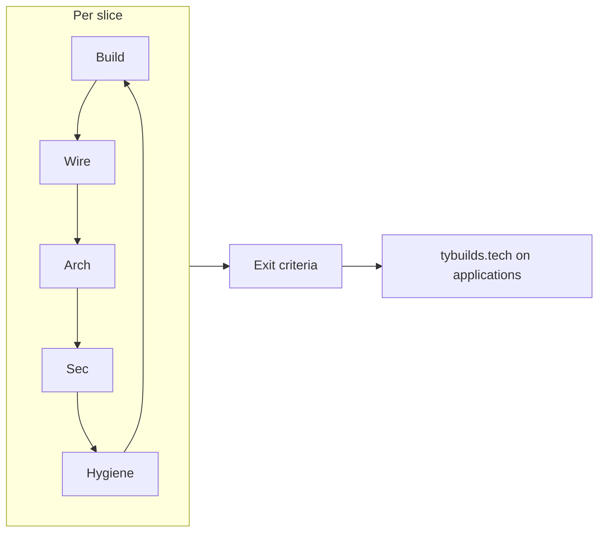

# Build Rhythm — Ellis / tybuilds.tech

**Canonical loop:** [`~/coding-home/templates/build-rhythm/BUILD_RHYTHM.md`](../coding-home/templates/build-rhythm/BUILD_RHYTHM.md)

**This file:** Ellis fork — related docs, Ellis-specific prompts, slice queue, rhythm gates in [BUILD_CHECKLIST.md](./BUILD_CHECKLIST.md).

```txt
Entrance  →  Build → Wire → Arch → Security → Hygiene  →  Exit
 "Should we?"              (repeat per slice)              "Ready?"
```

**Related:** [BUILD_ETHOS.md](./BUILD_ETHOS.md) · [ELLIS_ME_BUILD.md](./ELLIS_ME_BUILD.md) · [ELLIS_EXPERIENCE.md](./ELLIS_EXPERIENCE.md) · [ENTRANCE_CRITERIA.md](./ENTRANCE_CRITERIA.md) · [BUILD_CHECKLIST.md](./BUILD_CHECKLIST.md) · [WIRING_MAP.md](./WIRING_MAP.md) · [ARCHITECTURAL_DOCTRINE.md](./ARCHITECTURAL_DOCTRINE.md) · [ARCHITECTURE_CHECKLIST.md](./ARCHITECTURE_CHECKLIST.md) · [SECURITY_CHECKLIST.md](./SECURITY_CHECKLIST.md) · [HYGIENE_CHECKLIST.md](./HYGIENE_CHECKLIST.md) · [EXIT_CRITERIA.md](./EXIT_CRITERIA.md) · [STYLE.md](./STYLE.md) · [`~/coding-home/projects/tybuilds/HANDOFF.md`](../../../coding-home/projects/tybuilds/HANDOFF.md)

**Status:** Pre-scaffold — onboarding before code (2026-06-09). Planning docs complete; knowledge pack + repo scaffold next.

**Before every Build step:** Read [BUILD_ETHOS.md](./BUILD_ETHOS.md). No patches — gut wrong shape, rebuild clean.

---

## Finish lines (Ellis)

| Step                   | Question                                                                                                                 |
| ---------------------- | ------------------------------------------------------------------------------------------------------------------------ |
| **Build**              | Slice works — happy path manual test (chat streams, project page loads, demo embeds)?                                    |
| **Wire**               | Traceable in `WIRING_MAP.md`?                                                                                            |
| **Architecture audit** | Knowledge boundaries + route ownership match doctrine? → [ARCHITECTURE_CHECKLIST.md](./ARCHITECTURE_CHECKLIST.md)        |
| **Security audit**     | Anon cannot abuse API, exfiltrate keys, or access non-public content? → [SECURITY_CHECKLIST.md](./SECURITY_CHECKLIST.md) |
| **Hygiene audit**      | Touched files clean — build/lint, no dead/dupes/known bugs? → [HYGIENE_CHECKLIST.md](./HYGIENE_CHECKLIST.md) Core        |

Hygiene **after** security. Hygiene **appendix** = deep pass before first application send, not every slice.

---

## Steps 1–5

Full step definitions: **canonical** [`BUILD_RHYTHM.md`](../coding-home/templates/build-rhythm/BUILD_RHYTHM.md).

### Ellis deltas

**Build:** Match planned stack conventions. Knowledge shelf read-only at runtime. No visitor DB until explicitly scoped.

**Wire:** Update `docs/WIRING_MAP.md` + relevant build specs. Confirm Ellis API cannot write to knowledge files from visitor input.

**Architecture audit:** [ARCHITECTURE_CHECKLIST.md](./ARCHITECTURE_CHECKLIST.md) — all CRITICAL + applicable CONDITIONAL for the slice.

**Security audit:** [SECURITY_CHECKLIST.md](./SECURITY_CHECKLIST.md) — Core CRITICAL + applicable CONDITIONAL. Minimum for public AI surface:

| Surface             | Ellis checks                                                        |
| ------------------- | ------------------------------------------------------------------- |
| `/api/ellis/stream` | Rate limit, no system prompt leak, no ty-facts mutation from user   |
| Knowledge files     | Server-only read; no client bundle of full earnest doc if sensitive |
| Static demos        | iframe/sandbox boundaries for Basement CRT                          |
| Env                 | `ANTHROPIC_API_KEY` server-only                                     |
| GoE tease route     | No private repo paths, no interior mechanics                        |

**Hygiene audit:** [HYGIENE_CHECKLIST.md](./HYGIENE_CHECKLIST.md) — **Core on touched files only**.

---

## Repeat



---

## Planned slice queue (pre-scaffold)

**You are here:** onboarding — no repo yet.

| #   | Slice                   | Status     | Notes                                                     |
| --- | ----------------------- | ---------- | --------------------------------------------------------- |
| 0   | Onboarding with Ty      | **→ Next** | Output: `ellis-self.md`, `ty-facts.json`, `ty-earnest.md` |
| 1   | Phase A scaffold        | Pending    | Next.js + Vercel + domain wiring                          |
| 2   | Ellis Hall + stream API | Pending    | Knowledge shelf injection                                 |
| 3   | Project rooms           | Pending    | Basement CRT, TL, GoE tease                               |
| 4   | Style pass              | Pending    | [STYLE.md](./STYLE.md) tokens                             |
| 5   | Application-ready       | Pending    | Run [EXIT_CRITERIA.md](./EXIT_CRITERIA.md)                |

Macro rhythm gates: [BUILD_CHECKLIST.md](./BUILD_CHECKLIST.md) (Phase A/B/C ⏸ sections).

---

## After all slices — exit criteria (not step 6)

When BUILD checklist says ship, run **[EXIT_CRITERIA.md](./EXIT_CRITERIA.md)** once — security + hygiene appendix, E2E, legal, observability, recovery, access.



---

## Anti-patterns (Ellis)

- Scaffold before onboarding produces approved knowledge pack.
- Ellis voice drift — first person as Ty, or invented resume facts.
- Stacking project rooms without WIRING_MAP updates.
- Public chat without rate limits or cost controls.
- GoE disclosure beyond moderate tease.

---

_Fork of canonical build rhythm · Last updated: 2026-06-10_
