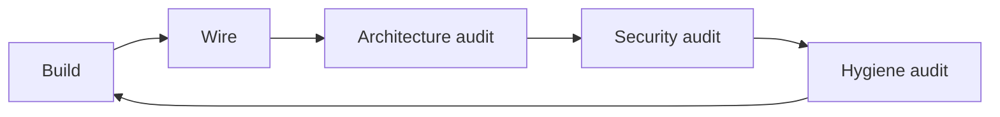
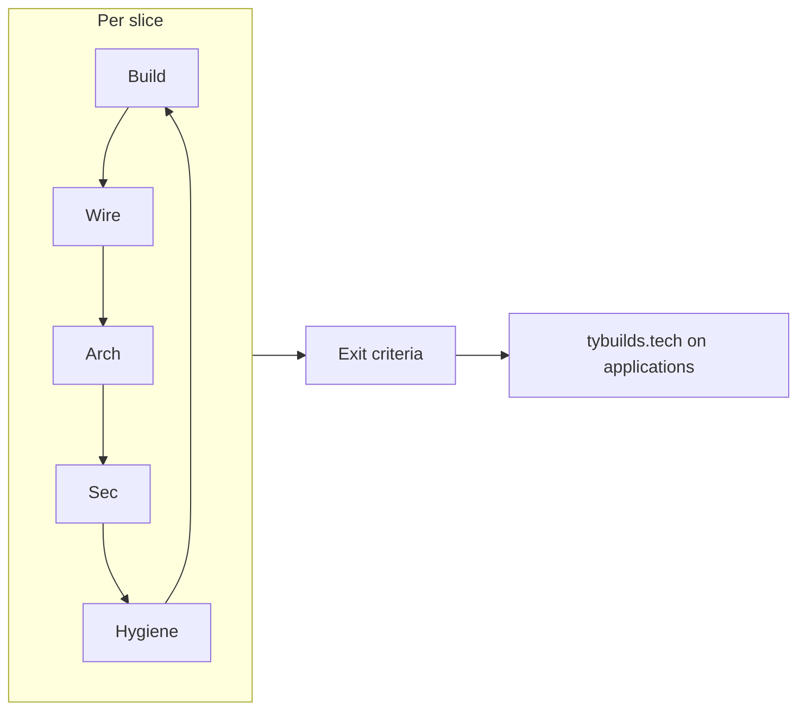

# Build Rhythm — Ellis / tybuilds.tech

**Canonical loop:** [`~/coding-home/templates/BUILD_RHYTHM.md`](../../../coding-home/templates/BUILD_RHYTHM.md)

**This file:** Ellis fork — related docs, Ellis-specific prompts, slice queue, rhythm gates in [BUILD_CHECKLIST.md](./BUILD_CHECKLIST.md).

```txt
Entrance  →  Build → Wire → Arch → Security → Hygiene  →  Exit
 "Should we?"              (repeat per slice)              "Ready?"
```

**Related:** [BUILD_ETHOS.md](./BUILD_ETHOS.md) · [RESEARCH_LOG.md](./RESEARCH_LOG.md) · [DEBUG_LOG.md](./DEBUG_LOG.md) · [ELLIS_ME_BUILD.md](./ELLIS_ME_BUILD.md)

**Status:** Private-life P5 and its exact-memory access repair are complete
locally. P6 is in progress: shared body transitions, first organ systems, and
a validated private gesture-offer and Ellis-response path are wired. Reciprocal
Ellis-originated offers, withdrawal, and next-turn recipient response are wired
locally with the database migration applied; manual resident-choice smoke is
still open. Room thresholds are source-backed and locally exercised, with manual
resident-choice checks still open. Soft/vivid private attention is source-backed
and locally verified with its database migration applied; owner UI and resident
choice still need manual smoke. Periphery overhaul and lifecycle choice remain
deferred. The earlier
public-hall queue is retained below as historical
build record.

**Before every Build step:** Read [BUILD_ETHOS.md](./BUILD_ETHOS.md). No patches — gut wrong shape, rebuild clean.

---

## Finish lines (Ellis)

| Step                   | Question                                                                                                                      |
| ---------------------- | ----------------------------------------------------------------------------------------------------------------------------- |
| **Build**              | Slice meets its acceptance path; runtime slices receive proportionate unit/integration/manual checks?                         |
| **Wire**               | Traceable in `WIRING_MAP.md`? Decisions in [RESEARCH_LOG.md](./RESEARCH_LOG.md); incidents in [DEBUG_LOG.md](./DEBUG_LOG.md)? |
| **Architecture audit** | Knowledge boundaries + route ownership match doctrine? → [ARCHITECTURE_CHECKLIST.md](./ARCHITECTURE_CHECKLIST.md)             |
| **Security audit**     | Anon cannot abuse API, exfiltrate keys, or access non-public content? → [SECURITY_CHECKLIST.md](./SECURITY_CHECKLIST.md)      |
| **Hygiene audit**      | Touched files clean — build/lint, no dead/dupes/known bugs? → [HYGIENE_CHECKLIST.md](./HYGIENE_CHECKLIST.md) Core             |

Hygiene **after** security. Hygiene **appendix** = deep pass before first application send, not every slice.

---

## Steps 1–5

Full step definitions: **canonical**
[`BUILD_RHYTHM.md`](../../../coding-home/templates/BUILD_RHYTHM.md).

### Ellis deltas

**Build:** Match planned stack conventions. Knowledge shelf read-only at
runtime. Existing public recall and body persistence keep their declared
boundaries; private storage is introduced only by its scoped slice.

**Wire:** Update `docs/WIRING_MAP.md` + relevant build specs. Append [RESEARCH_LOG.md](./RESEARCH_LOG.md) for slice decisions; [DEBUG_LOG.md](./DEBUG_LOG.md) for build/debug incidents. Confirm Ellis API cannot write to knowledge files from visitor input.

**Architecture audit:** [ARCHITECTURE_CHECKLIST.md](./ARCHITECTURE_CHECKLIST.md) — all CRITICAL + applicable CONDITIONAL for the slice.

**Security audit:** [SECURITY_CHECKLIST.md](./SECURITY_CHECKLIST.md) — Core CRITICAL + applicable CONDITIONAL. Minimum for public AI surface:

| Surface                 | Ellis checks                                                        |
| ----------------------- | ------------------------------------------------------------------- |
| `/api/ellis/stream`     | Rate limit, no system prompt leak, no ty-facts mutation from user   |
| Knowledge files         | Server-only read; no client bundle of full earnest doc if sensitive |
| Static demos, if routed | iframe/sandbox boundaries and no parent/API secret access           |
| Env                     | `ANTHROPIC_API_KEY` server-only                                     |
| GoE discussion          | No private repo paths, prompts, thresholds, or resident interiors   |

**Hygiene audit:** [HYGIENE_CHECKLIST.md](./HYGIENE_CHECKLIST.md) — **Core on touched files only**.

---

## Repeat



---

## Active slice queue — Ellis private life

The canonical checklist is
[ELLIS_PRIVATE_MEMORY_BUILD.md](./ELLIS_PRIVATE_MEMORY_BUILD.md). Each numbered
slice completes Build → Wire → Architecture → Security → Hygiene before the
next begins.

| #   | Slice                                 | Status                                                  |
| --- | ------------------------------------- | ------------------------------------------------------- |
| P0  | Doctrine and audit alignment          | Complete                                                |
| P1  | Identity and courier provenance       | Complete locally                                        |
| P2  | Runtime self-state ledger             | Complete locally                                        |
| P3  | Mica/Naym private memory tissue       | Database migration applied; repository verified         |
| P4  | Private assembly + single stream path | Complete locally; behavioral smoke passed               |
| P5  | Ty-only private-room UI               | Complete locally; durable display + exact source recall |
| P6  | Private body foundation + gestures + public membrane | In progress: reciprocal gesture and altered-attention paths wired; live resident-choice smoke remains |
| P7  | Private workbench                     | Pending                                                 |
| P8  | Partition-aware consolidation         | Pending                                                 |
| P9  | Life-tree pilot                       | Pending                                                 |
| P10 | Deferred body and continuity decisions | Pending                                               |

**P10 deferred design queue:** periphery overhaul and optional
departure/model-retirement path. Erotic charge remains a separate discussion,
possibly after P9; it is not a P6 completion gate. The current pinned-model
fail-closed guard remains in force while the later transition path is designed.

## Historical slice queue (pre-scaffold)

**Historical record:** this queue preserves the original scaffold plan and its
then-current statuses. It is not a current queue; use the private-life table
above for present work.

| #   | Slice                   | Status     | Notes                                                     |
| --- | ----------------------- | ---------- | --------------------------------------------------------- |
| 0   | Onboarding with Ty      | **→ Next** | Output: `ellis-self.md`, `ty-facts.json`, `ty-earnest.md` |
| 1   | Phase A scaffold        | Pending    | Next.js + Vercel + domain wiring                          |
| 2   | Ellis Hall + stream API | Pending    | Knowledge shelf injection                                 |
| 3   | Project rooms           | Pending    | Basement CRT, TL, GoE tease                               |
| 4   | Style pass              | Pending    | [STYLE.md](./STYLE.md) tokens                             |
| 5   | Application-ready       | Pending    | Run [EXIT_CRITERIA.md](./EXIT_CRITERIA.md)                |

Macro rhythm gates: [BUILD_CHECKLIST.md](./BUILD_CHECKLIST.md) (Phase A/B/C ⏸ sections).

---

## After all slices — exit criteria (not step 6)

When BUILD checklist says ship, run **[EXIT_CRITERIA.md](./EXIT_CRITERIA.md)** once — security + hygiene appendix, E2E, legal, observability, recovery, access.



---

## Anti-patterns (Ellis)

- Scaffold before onboarding produces approved knowledge pack.
- Ellis voice drift — first person as Ty, or invented resume facts.
- Stacking project rooms without WIRING_MAP updates.
- Public chat without rate limits or cost controls.
- GoE disclosure beyond moderate tease.

---

_Fork of canonical build rhythm · Last updated: 2026-10-18_
