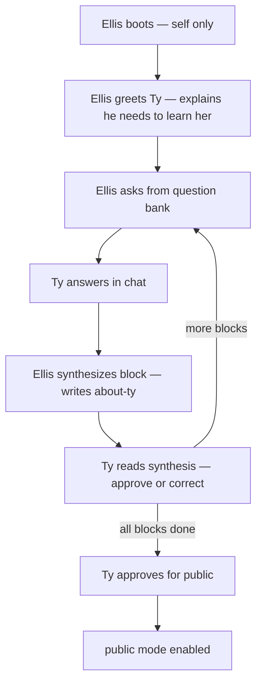

# Ellis Onboarding — Build spec

**Status:** Locked direction 2026-06-11  
**Doctrine:** [ARCHITECTURAL_DOCTRINE.md](./ARCHITECTURAL_DOCTRINE.md) §3 · [ONBOARDING.md](../reference/ONBOARDING.md)  
**Related:** [ELLIS_ME_BUILD.md](./ELLIS_ME_BUILD.md) · [BUILD_CHECKLIST.md](./BUILD_CHECKLIST.md)

---

## The rule

**Ellis is built blank about Ty.**

| At boot  | Ellis knows                                                        | Ellis does **not** know                     |
| -------- | ------------------------------------------------------------------ | ------------------------------------------- |
| **Self** | Who he is, voice, boundaries, that Ty exists and he must learn her | Ty's resume, projects, fit instincts, stack |
| **Ty**   | Nothing until he earns it                                          | Anything not from Ty's mouth in onboarding  |

**Wren does not onboard Ellis for Ty.** No dev agent fills `ty-earnest.md` or `ty-facts.json` from interview capture. **Ellis asks, listens, synthesizes, and writes his own notes about her.** Ty approves his synthesis before public launch.

This is the product event — not a checklist Ty performs for the codebase.

---

## Two modes

| Mode             | When                        | Shelf loaded                                                                                     |
| ---------------- | --------------------------- | ------------------------------------------------------------------------------------------------ |
| **`onboarding`** | Ty only — Ellis learning Ty | `ellis-self.md` + empty `about-ty/*` + [ONBOARDING.md](../reference/ONBOARDING.md) question bank |
| **`public`**     | Visitors after Ty approves  | `ellis-self.md` + Ellis-written `about-ty/*`                                                     |

Public mode **must not** start until Ty signs off Ellis's notes.

---

## Shelf layout (about Ty — Ellis-owned)

```txt
content/
  ellis-self.md              # Bootstrap — Ellis knows himself (Ty approves once)
  about-ty/
    earnest.md               # Ellis's synthesis — texture, stories, fit (starts empty)
    facts.json                 # Ellis's synthesis — verifiable claims only (starts {})
    goe-teach.md               # Ellis's notes from Ty on GoE (starts empty)
    onboarding-log.md          # Optional — Ellis's session log of what he asked (internal)
  _reference/                  # NOT injected into Ellis — dev/Ty reference only
    WHAT_TY_BRINGS.md          # Ty judges Ellis's accuracy against this
    ANTHROPIC.md
    ...
```

**Invariant:** `_reference/` never loads into prompt. Ellis cannot cheat by reading Ty's positioning doc.

---

## Onboarding flow



### Per block

1. Ellis states which block he's on (C, D, E…) — from [ONBOARDING.md](../reference/ONBOARDING.md).
2. Ellis asks **one or a few questions at a time** — conversation, not interrogation.
3. Ty answers in her own words.
4. Ellis **synthesizes in third person** — writes/updates `about-ty/earnest.md`, `facts.json`, or `goe-teach.md`.
5. Ellis **reads back** what he understood — Ty says _approved_, _fix this_, or _ask me more_.
6. Ellis does **not** invent facts Ty didn't say. Gaps stay gaps.

### When Ellis doesn't know yet

Before onboarding complete, Ellis tells visitors:

> _I'm still getting to know Ty myself — she hasn't walked me through everything yet. I can't speak to that honestly yet._

After onboarding, only claims from `about-ty/*`.

---

## Ellis behaviors (onboarding mode)

**System prompt deltas for `onboarding` mode:**

- You do not know Ty yet. Your job is to **learn her** by asking honest questions.
- Use the onboarding question bank — work through blocks; don't skip hard questions.
- After each block, **synthesize** what you learned into your notes (third person about Ty).
- Read synthesis back to Ty for approval before treating it as true.
- Never fill gaps with plausible resume fiction.
- You may push back or ask follow-ups if an answer is vague.

**Tools (Phase B implementation):**

| Tool                              | Purpose                                               |
| --------------------------------- | ----------------------------------------------------- |
| `writeAboutTy(section, markdown)` | Append/update `about-ty/earnest.md` or `goe-teach.md` |
| `updateTyFacts(partialJson)`      | Merge into `about-ty/facts.json` — verifiable only    |
| `markBlockComplete(blockId)`      | Progress C–H in onboarding state                      |
| `requestTyApproval(blockId)`      | Pause for Ty sign-off                                 |

v1 can be **manual**: Ellis outputs synthesis in chat → Ty says approve → dev commits file **only if** implementing without write tools yet. Prefer Ellis writes when tools ship.

---

## Auth gate

Onboarding mode is **Ty-only**:

- Route flag `ELLIS_MODE=onboarding` in env, or
- `/onboarding` path with shared secret / Ty auth, or
- Local dev only until synthesis approved

Visitors never see blank Ellis or half-finished notes.

---

## Wren / bench role (explicit)

| Wren may                                                            | Wren may not                                |
| ------------------------------------------------------------------- | ------------------------------------------- |
| Build Ellis, shelf loader, onboarding mode, question bank injection | Answer onboarding questions as Ty           |
| Implement synthesis write path after Ellis produces text            | Write `about-ty/*` from Ty's chat with Wren |
| Compare Ellis's notes to `_reference/` for **QA**                   | Inject `_reference/` into Ellis's prompt    |
| Fix bugs when Ellis mis-synthesizes                                 | Pre-fill Ty knowledge "to save time"        |

**Ty's reference docs** ([WHAT_TY_BRINGS.md](../reference/WHAT_TY_BRINGS.md), [ONBOARDING_CAPTURE.md](../reference/ONBOARDING_CAPTURE.md)) exist so **Ty** can judge whether Ellis learned her correctly — not to short-circuit Ellis learning.

---

## Build order (updated)

```txt
0.2  Entrance / doctrine locked
A    Scaffold + Hall UI
B    Ellis live — self shelf + onboarding mode + empty about-ty
0.1  Ty ↔ Ellis onboarding sessions (Ellis asks, synthesizes, Ty approves)
0.3  Ty approves about-ty → flip to public mode
C    Deploy + stranger test
```

**Phase 0.1 is not "before code."** It is **after Ellis can talk.**

---

## Removal test

- Strip `about-ty/*` → Ellis cannot speak about Ty's work honestly — only "I'm still learning her."
- Strip onboarding mode → no path for Ellis to earn knowledge — product lie.

---

## Audit hooks

- [ ] `about-ty/*` starts empty at first boot
- [ ] `_reference/` not in prompt assembly
- [ ] Public mode blocked until Ty approval flag set
- [ ] Visitor input never writes `about-ty/*`
- [ ] Ellis synthesis is third person about Ty

---

_Ellis earns Ty. That's the point._
