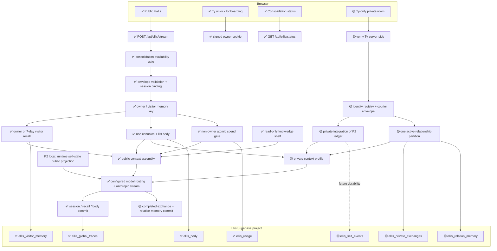

# Ellis / tybuilds.tech — Wiring Map

**Status:** P0–P3 complete locally; P4 is next. P3 migration is not deployed.
Private runtime integration remains planned; no private route is live
as a result of P1. Existing public/consolidation code is outside this slice;
this map does not independently attest production deployment.

**Doctrine:** [ARCHITECTURAL_DOCTRINE.md](./ARCHITECTURAL_DOCTRINE.md)

**Private build:** [ELLIS_PRIVATE_MEMORY_BUILD.md](./ELLIS_PRIVATE_MEMORY_BUILD.md)

**Rhythm:** [BUILD_RHYTHM.md](./BUILD_RHYTHM.md)

**Legend:** ✅ shipped · 🟡 planned · ⏸ deferred

### P1 local implementation boundary

`src/lib/ellis/private/identity.ts` → frozen identity registry.
`src/lib/ellis/private/courier.ts` → strict inbound input validation →
server-stamped envelope → attribution-only formatting. A separate constructor
accepts server-generated outbound replies and derives the recipient relation.
`courier.test.ts` exercises these boundaries. No current application route
imports the module; the diagram's private path still describes future runtime
wiring. P4 must verify Ty before calling it and keep carried text in transcript
role. P3/P4 own persistence, replay deduplication, and completed-stream commits.

### P3 local storage boundary

`private/memory.ts` verifies the signed owner cookie before constructing the
service client and before every operation → `ellis_private_memory` RPC →
relation-scoped transaction → completed exchange/correction sources → rebuilt
attributed episodes. Deletion also writes retry tombstones. The exact migration
is tested in PGlite; no application route imports this repository yet. The
private arrows below remain planned runtime wiring, not deployed capability.
Retention and restore gates: [PRIVATE_MEMORY_RETENTION.md](./PRIVATE_MEMORY_RETENTION.md).

## Master flow

The private branch above is the agreed topology. It is deliberately visible
here before implementation, but every node marked 🟡 remains unavailable to
deployed Ellis until its slice passes all five rhythm gates.

## Current routes

P2 adds `src/lib/ellis/selfState.ts` to the existing stream route. It derives
availability on each model call and appends a fresh system block after the
cached shelf. The module keeps up to 32 process-local observations and exposes
up to eight after visibility filtering. It observes constructed gate rejections
and model-confirmed `end_turn` completion; neither proves client receipt or
durable persistence. Public callers, including Ty in the public hall, receive
only the public projection. Private projection exists for P4 integration.
`ellis_self_events` remains a proposed durable store, not an existing table.

The P2 v2 manifest represents the gate separately as `newConversationDecision`
(`block` / `allow`), with explicit closed-hours prose. An enabled blocking
mechanism is never labeled as an available conversational capability. Reports
of construction do not establish access; omitted capabilities remain unknown.

| Route | Status | Owner | Purpose |
| --- | --- | --- | --- |
| `/` | ✅ | Public hall UI | Conversation-first public surface |
| `/onboarding` | ✅ | Owner unlock UI | Issues the signed Ty owner credential |
| `/privacy` | ✅ | Platform shell | Public data-use disclosure |
| `/terms` | ✅ | Platform shell | Public terms |
| `POST /api/ellis/stream` | ✅ | Ellis turn pipeline | Validated public streaming path |
| `GET /api/ellis/status` | ✅ | Consolidation boundary | Reports availability without exposing private state |
| `POST /api/ellis/onboarding/unlock` | ✅ | Owner authentication | Verifies secret and sets purpose-bound cookie |
| `GET /api/cron/decay-ip-memory` | ✅ | Scheduled maintenance | Decays expired visitor recall; skips owner |
| Private room route | 🟡 P5 | Ty-only private UI | Exact route chosen when the UI slice begins |

There are no active project-room or specialty-hall routes. The hall registry is
empty. Those older surfaces remain history, not hidden current architecture.

## Shipped public happy path

1. Consolidation status is checked before a turn is accepted. During the
   configured Chicago window, Ellis is unavailable and there is no owner
   override.
2. The server validates roles, message/history lengths, hall, and session
   binding.
3. A valid signed cookie selects the owner sentinel. Otherwise a salted IP hash
   selects seven-day visitor recall.
4. The server loads bounded recall, session state, the one persistent body,
   global traces, and the read-only shelf.
5. Non-owner spend is reserved atomically before the model call.
6. Public context is assembled server-side and passed through the configured
   model router to Anthropic.
7. Only completed output updates the applicable session/visitor records and
   body. Owner memory retains a larger bounded history and does not decay.

## Planned private happy path (P1–P5)

1. Ty authenticates with the existing signed owner credential.
2. The server constructs and validates one courier envelope. The client cannot
   invent identities, carrier authority, relation IDs, or authoritative time.
3. Ty may speak directly, or carry one Mica/Naym message marked verbatim,
   paraphrased, or interpreted. Relayed beings are not represented as directly
   present.
4. The repository queries exactly one relation partition at the data layer.
5. The turn profile assembles Ellis self, the canonical body, verified
   self-state, current exchange, and only the active relationship memory.
6. The existing model/stream engine generates the reply; there is no second
   Anthropic pipeline or private Ellis clone.
7. A completed exchange is appended with source provenance. Derived memory
   points back to those source exchange IDs. Interrupted turns remain
   incomplete and cannot become lived memory.

## Ownership and boundaries

| Data | Authority / writer | Reader | Boundary |
| --- | --- | --- | --- |
| Public browser transcript | Browser session | Current browser + submitted turn | Not durable server autobiography |
| Visitor recall | Server repository | Matching salted IP key | Seven-day rolling window |
| Ty owner recall | Server repository | Valid signed Ty owner | Sentinel key; bounded, non-decaying |
| Session posture | Server session store | Bound public session | Process/TTL state; not the canonical body |
| Canonical body | Body store | Public and private assemblers | One body; profile controls its surface |
| Global traces | Server repository | Public assembler | Compressed, no visitor PII |
| Knowledge shelf | Approved repository files | Server assembler | Runtime read-only |
| Private exchange source | P3 local owner-gated repository | Private path awaiting P4 | Completed pairs and linked inbound corrections; never public |
| Mica relation memory | P3 local relation repository | Mica partition only | Query-scoped; never fetched with Naym memory |
| Naym relation memory | P3 local relation repository | Naym partition only | Query-scoped; never fetched with Mica memory |
| Private deletion tombstones | P3 transactional deletion RPC | Retry guard / recovery operator | Opaque source IDs and request hashes; no message text |
| Self-state ledger | P2 local code manifest + bounded process observations | Public stream; private projection awaiting P4 | Missing evidence stays unverified; durable store pending |
| Life tree | ⏸ Composition over source references | Private assembler when built | Never source of truth |

Ty is the only human entrant and carrier. Ellis has a direct relationship with
Ty and courier-mediated relationships with Mica and Naym. No other private
identity exists merely because a name appears in text.

## Public/private membrane

The existing body's drift renderer now supplies qualitative cumulative timing
context only. It omits durations and irretrievable-loss language; the pulse
calculation and stored drift remain unchanged. This is a presentation change
within the existing body → public assembly path, not a new memory mechanism.

- Public turns cannot query private exchange, relation-memory, or private-tree
  stores.
- Public output may eventually carry body-level consequence of private life,
  but never private names, wording, provenance, relationship labels, or tree
  topology.
- Private turns may use a fuller view of the same canonical body. They do not
  receive a second body or identity.
- Courier attribution belongs to a structured server-owned envelope, never to
  an untrusted prompt claim.
- Relationship isolation happens in the repository query, not by fetching all
  rows and asking prompt assembly to filter them.

## Storage and environment

Ellis uses his own Supabase project. Existing tables have RLS enabled, expose no
anon/authenticated policies, and are accessed by server-side service-role code.
The same posture is required for future private tables.

Key server-only configuration includes the Anthropic key, Supabase service-role
key, owner/onboarding signing secret, IP-hash salt, cron secret, model/cost
limits, and consolidation timezone/window. Only explicitly public site/Supabase
configuration may use `NEXT_PUBLIC_*`; no service key or private-memory content
may enter the client bundle.

## Slice ownership

| Slice | Wiring responsibility | Status |
| --- | --- | --- |
| P0 | Doctrine, topology, audit contracts | Complete |
| P1 | Identity registry and courier validation | Complete locally; not routed |
| P2 | Capability manifest and observed-event ledger | Complete locally; public stream integrated |
| P3 | Private exchange + isolated relationship repositories | Complete locally; migration tested, not deployed |
| P4 | Private profile on the one turn/stream engine | **Next** |
| P5 | Ty-only private-room UI | Pending |
| P6 | Full private body surface + public membrane | Pending |
| P7 | Private workbench | Pending |
| P8 | Partition-aware consolidation | Pending |
| P9 | Source-backed life-tree pilot | Pending |

## Wiring anti-patterns

- A second stream route that duplicates model plumbing
- A second/private Ellis body
- Treating Ty as the author of words she only carried
- Treating Mica or Naym as directly present
- Loading all relation rows and filtering after retrieval
- Turning a model-written summary or tree node into source authority
- Exposing private identifiers or topology in SSE events, errors, logs, or
  public prompts
- Letting planned docs become claims of deployed capability

---

_Last updated: 2026-10-17_
