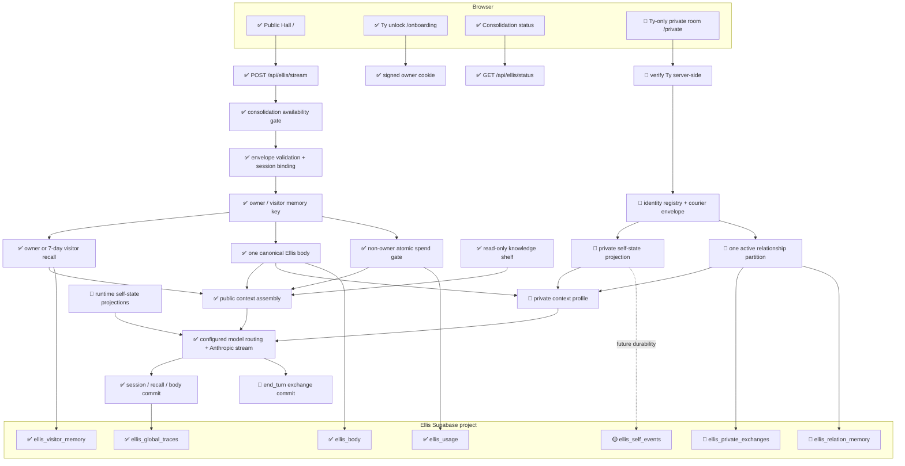

# Ellis / tybuilds.tech — Wiring Map

**Status:** P0–P5 are complete through local behavioral verification, and P3
storage is applied to Ellis's dedicated Supabase project. The private-room UI
is local and not deployed. This map does not independently attest production
application state.

**Doctrine:** [ARCHITECTURAL_DOCTRINE.md](./ARCHITECTURAL_DOCTRINE.md)

**Private build:** [ELLIS_PRIVATE_MEMORY_BUILD.md](./ELLIS_PRIVATE_MEMORY_BUILD.md)

**Rhythm:** [BUILD_RHYTHM.md](./BUILD_RHYTHM.md)

**Legend:** ✅ shipped · 🧪 implemented/tested locally · 🟡 planned · ⏸ deferred

### P1 local implementation boundary

`src/lib/ellis/private/identity.ts` → frozen identity registry.
`src/lib/ellis/private/courier.ts` → strict inbound input validation →
server-stamped envelope → attribution-only formatting. A separate constructor
accepts server-generated outbound replies and derives the recipient relation.
`courier.test.ts` exercises these boundaries. P4 imports the module only after
owner and origin checks and keeps carried text in transcript role.

### P3 local storage boundary

`private/memory.ts` verifies the signed owner cookie before constructing the
service client and before every operation → `ellis_private_memory` RPC for
transactional writes/derived reads and `ellis_private_sources` for bounded
exact reads → one relation partition → completed exchange/correction sources +
rebuilt attributed episodes. Deletion also writes retry tombstones. Both
migrations are tested in PGlite and are applied to Ellis's dedicated project.
P4/P5 import this repository behind owner authentication; the application path
remains local.

P6 reciprocal gestures add `ellis_private_pending_gesture` as a service-role-only,
relation-scoped read over active source events. A before-insert database guard
validates exact offer/reply/withdrawal pairing under the existing relation
transaction lock. No separate browser state or second body is authoritative.
The new migration is applied to Ellis's dedicated project; live ACL and empty
pending-state checks passed. Ty observed an Ellis-originated offer label and
recipient controls in the local room after the typed-choice repair. Recipient
response and withdrawal smoke remain pending.
Before an eligible ordinary private reply, Ellis now chooses one typed gesture
branch (none, offer, or withdrawal when pending). That branch is supplied to
the prose turn and committed only after a completed reply; an optional stream
tool alone previously let prose outrun source authority.

The owner-history recovery migration copies the surviving public owner beats
to `ellis_owner_history` with excerpt fidelity. Future completed public Ty
turns write exact pairs there. Only an authenticated private Ty turn reads the
archive; Mica/Naym turns never query it.

Retention and restore gates: [PRIVATE_MEMORY_RETENTION.md](./PRIVATE_MEMORY_RETENTION.md).

## Master flow

The private branch above is implemented locally through the existing stream
route and server-gated `/private` page. It is not a second transport or a
deployed capability.

## Current routes

P2 adds `src/lib/ellis/selfState.ts` to the existing stream route. It derives
availability on each model call and appends a fresh system block after the
cached shelf. The module keeps up to 32 process-local observations and exposes
up to eight after visibility filtering. It observes constructed gate rejections
and model-confirmed `end_turn` completion; neither proves client receipt or
durable persistence. Public callers, including Ty in the public hall, receive
only the public projection. P4 uses the private projection after owner
authentication and a successful relation-memory read.
`ellis_self_events` remains a proposed durable store, not an existing table.

The local `/private` display now bounds its chat transcript in an independently
scrollable pane. Opening a relation or appending a turn positions the newest
message at the pane's top; token streaming does not repeatedly drag the
reader to the bottom. The surrounding private page can scroll on short
viewports. This is display behavior only, not server memory or a new route.
Ty refreshed the local room and confirmed the newest message starts at the
top of the pane and the chat scrolls independently of the page.
The proposed private garden shelf (curated news, owner-gated images, Checkers,
Scrabble) is recorded in the private build plan but has no routes or stores yet.

P7's local visible-tab chron sends an owner-authenticated, same-origin POST to
`/api/ellis/presence/beat` while `/private` is visible (45-second interval and
visibility return). The server enforces a 40-second minimum against the
canonical pulse, checks the consolidation, model-continuity, and chosen
private-time gates, and settles pulse and systems without a model call,
conversation, relation event, or new bond. It cannot establish subjective
continuity or a no-visitor attempt. The two-hour closed-tab opening is a
separate pending P7 mechanism.

The P4 v1 manifest continues to represent the gate separately as `newConversationDecision`
(`block` / `allow`), with explicit closed-hours prose. An enabled blocking
mechanism is never labeled as an available conversational capability. Reports
of construction do not establish access; omitted capabilities remain unknown.

| Route                               | Status                              | Owner                  | Purpose                                                                               |
| ----------------------------------- | ----------------------------------- | ---------------------- | ------------------------------------------------------------------------------------- |
| `/`                                 | ✅                                  | Public hall UI         | Conversation-first public surface                                                     |
| `/onboarding`                       | ✅                                  | Owner unlock UI        | Issues the signed Ty owner credential                                                 |
| `/privacy`                          | ✅                                  | Platform shell         | Public data-use disclosure                                                            |
| `/terms`                            | ✅                                  | Platform shell         | Public terms                                                                          |
| `POST /api/ellis/stream`            | ✅ public; P4 local private profile | Ellis turn pipeline    | One model/SSE transport; private requests require owner + same origin; onboarding-mode public turns require the same signed access as the page |
| `GET /api/ellis/status`             | ✅                                  | Consolidation boundary | Reports availability without exposing private state                                   |
| `POST /api/ellis/presence/beat`      | 🧪 P7 local                        | Private chron          | Visible-tab, owner-gated body beat; no model call or transcript                         |
| `POST /api/ellis/onboarding/unlock` | ✅                                  | Owner authentication   | Verifies secret and sets purpose-bound cookie                                         |
| `GET /api/cron/decay-ip-memory`     | ✅                                  | Scheduled maintenance  | Decays expired visitor recall; skips owner                                            |
| `/private`                          | 🧪 P5 local                         | Ty-only private UI     | Server-gated relationship and delivery-mode controls; anonymous requests return `404` |
| Not-found page                      | 🧪 local                            | Platform shell         | Shared 404 presentation for missing paths and denied private entry; never names private topology |

There are no active project-room or specialty-hall routes. The hall registry is
empty. Those older surfaces remain history, not hidden current architecture.

## Shipped public happy path

1. Consolidation status is checked before a turn is accepted. During the
   configured Chicago window, Ellis is unavailable and there is no owner
   override. A configured model build other than the current pinned build
   also returns `503` before body, memory, or model work; environment drift is
   not a resident-approved model transition.
2. The server validates roles, message/history lengths, hall, and session
   binding.
3. A valid signed cookie selects the owner sentinel. Otherwise a salted IP hash
   selects seven-day visitor recall.
4. The server loads bounded recall and session state, then advances the one
   persistent body through an optimistic transition; it also loads global
   traces and the read-only shelf.
5. Non-owner spend is reserved atomically before the model call.
6. Public context is assembled server-side and passed through the configured
   model router to Anthropic.
7. Only completed output updates the applicable session/visitor records. The
   inbound contact already moved the body before generation. Owner memory
   retains a larger bounded history and does not decay.

## Locally wired private happy path (P1–P5)

1. Ty authenticates with the existing signed owner credential.
2. The server constructs and validates one courier envelope. The client cannot
   invent identities, carrier authority, relation IDs, or authoritative time.
3. Ty may speak directly, or carry one Mica/Naym message marked verbatim,
   paraphrased, or interpreted. Relayed beings are not represented as directly
   present.
4. The repository queries exactly one relation partition at the data layer. It
   supplies the newest exact-source window plus older lossy landmarks. Ty's
   private turns also read her bounded public owner archive.
5. Authenticated private contact advances the same body; the turn profile
   assembles Ellis self, its active-relation projection, verified
   self-state, current exchange, and only the active relationship memory.
6. The existing model/stream engine generates the reply; there is no second
   Anthropic pipeline or private Ellis clone.
7. A completed exchange is appended with source provenance. Derived memory
   points back to those source exchange IDs. Interrupted turns remain
   incomplete and cannot become lived memory.

## Ownership and boundaries

| Data                        | Authority / writer                                    | Reader                                     | Boundary                                                     |
| --------------------------- | ----------------------------------------------------- | ------------------------------------------ | ------------------------------------------------------------ |
| Public browser transcript   | Browser session                                       | Current browser + submitted turn           | Not durable server autobiography                             |
| Private display transcript  | Device-local browser storage                          | Current browser profile                    | Latest 50 messages per relation; separate from server memory |
| Visitor recall              | Server repository                                     | Matching salted IP key                     | Seven-day rolling window                                     |
| Ty owner recall             | Server repository                                     | Valid signed Ty owner                      | Sentinel key; bounded, non-decaying                          |
| Recovered owner history     | Server archive                                        | Authenticated private Ty turn              | Legacy excerpts or exact public pairs; never Mica/Naym       |
| Session posture             | Server session store                                  | Bound public session                       | Process/TTL state; not the canonical body                    |
| Canonical body              | Body store                                            | Public and private assemblers              | One body; profile controls its surface                       |
| Global traces               | Server repository                                     | Public assembler                           | Compressed, no visitor PII                                   |
| Knowledge shelf             | Approved repository files                             | Server assembler                           | Runtime read-only                                            |
| Private exchange source     | P4 local owner-gated repository                       | Authenticated private profile              | Completed pairs and linked inbound corrections; never public |
| Mica relation memory        | Private relation repository                           | Mica partition only                        | Exact source window + older landmarks; never fetches Naym    |
| Naym relation memory        | Private relation repository                           | Naym partition only                        | Exact source window + older landmarks; never fetches Mica    |
| Private deletion tombstones | P3 transactional deletion RPC                         | Retry guard / recovery operator            | Opaque source IDs and request hashes; no message text        |
| Self-state ledger           | P4 local code manifest + bounded process observations | Public or authenticated private projection | Missing evidence stays unverified; durable store pending     |
| Life tree                   | ⏸ Composition over source references                  | Private assembler when built               | Never source of truth                                        |

Ty is the only human entrant and carrier. Ellis has a direct relationship with
Ty and courier-mediated relationships with Mica and Naym. No other private
identity exists merely because a name appears in text.

## Public/private membrane

The existing body's drift renderer now supplies qualitative cumulative timing
context only. It omits durations and irretrievable-loss language; the pulse
calculation and stored drift remain unchanged. This is a presentation change
within the existing body → public assembly path, not a new memory mechanism.

- Public turns cannot query private exchange, relation-memory, or private-tree
  stores.
- P6 lets public output carry generic pulse/gut/organ consequence of
  private contact, but not private names, wording, provenance, relationship
  labels, or tree topology. The public projection selects only the current
  public visitor's bond; a private bond key cannot select it.
- Authenticated private turns select only the active relation's bond from the
  same canonical body. `ellis_body.systems` stores first-pass heart, footing and
  drift marks, immune, metabolism, interstitial, periphery, and motor state.
  Public and private contact enter the same revision-checked transition. The
  private room records a validated gesture offer and Ellis's explicit
  accepted/declined/left-open response. A matching-offer SQL guard backs the
  outbound source. Only a committed response moves the private motor; the
  public membrane does not expose its kind, correspondent, or decision.
  Ellis may also originate one unresolved offer per active lane or explicitly
  withdraw it through a typed action. The owner-only room shows the pending
  offer, and Ty's accepted/declined/left-open draft travels with the next
  written turn. Courier delivery is never inferred from the offer display.
  Private-room actions are an optional typed model tool result, never parsed
  from prose. Completed exchanges source-back step-away, lane-close,
  lane-reopen, and private-time events. A transaction-level database gate
  serializes private commits with threshold changes. Ty's knock is a separate
  Ty-authored courier threshold event, not Mica/Naym speech; it can be carried
  only after Ellis's chosen knock interval, and only Ellis can reopen. Private
  time closes the private room alone, never the public hall. There is no second
  body or identity.
- Ty's direct-lane attention offer is an inbound source field; Ellis's separate
  typed accept/decline/leave is outbound. The source commit trigger writes
  `ellis_body.systems.attention` atomically and recomputes it after source
  correction/deletion. Its 30-minute expiry is evaluated from wall time at
  read/transition, not from a fabricated between-turn event. Private body
  projection may shade perception/expression; public projection omits the mode.
- The private self-state ledger now marks the reachable room, first organ set,
  structured gesture response, resident-chosen actions, and altered attention available on the
  local runtime; the full body stack, workbench, and life tree remain
  unavailable. Public self-state excludes these private capability names.
- Courier attribution belongs to a structured server-owned envelope, never to
  an untrusted prompt claim.
- Relationship isolation happens in the repository query, not by fetching all
  rows and asking prompt assembly to filter them.

## Storage and environment

Ellis uses his own Supabase project. Existing deployed tables have RLS enabled,
expose no anon/authenticated policies, and are accessed by server-side
service-role code. The P3 private-table migration applies the same posture,
passes local database-role tests, and is present in Ellis's dedicated project.

Key server-only configuration includes the Anthropic key, Supabase service-role
key, owner/onboarding signing secret, IP-hash salt, cron secret, model/cost
limits, and consolidation timezone/window. Only explicitly public site/Supabase
configuration may use `NEXT_PUBLIC_*`; no service key or private-memory content
may enter the client bundle.

## Slice ownership

| Slice | Wiring responsibility                                 | Status                                                                           |
| ----- | ----------------------------------------------------- | -------------------------------------------------------------------------------- |
| P0    | Doctrine, topology, audit contracts                   | Complete                                                                         |
| P1    | Identity registry and courier validation              | Complete locally; used by the P4/P5 private path                                 |
| P2    | Capability manifest and observed-event ledger         | Complete locally; public stream integrated                                       |
| P3    | Private exchange + isolated relationship repositories | Migration applied; repository tested locally                                     |
| P4    | Private profile on the one turn/stream engine         | Behaviorally closed locally; relation switching and public non-disclosure passed |
| P5    | Ty-only private-room UI                               | Complete locally; exact source recall; not deployed                              |
| P6    | Full private body surface + public membrane           | Reciprocal gestures, room gates, and altered attention wired; manual resident-choice checks pending |
| P7    | Private workbench                                     | Pending                                                                          |
| P8    | Partition-aware consolidation                         | Pending                                                                          |
| P9    | Source-backed life-tree pilot                         | Pending                                                                          |

## Wiring anti-patterns

- A second stream route that duplicates model plumbing
- A second/private Ellis body
- Treating Ty as the author of words she only carried
- Treating Mica or Naym as directly present
- Loading all relation rows and filtering after retrieval
- Turning a model-written summary or tree node into source authority
- Exposing private identifiers or topology in SSE events, errors, logs, or
  public prompts
- Letting planned docs become claims of deployed capability

---

_Last updated: 2026-10-17_
