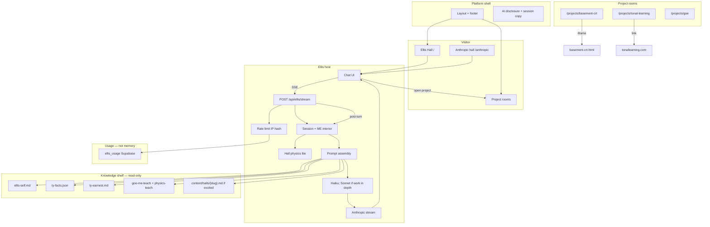

# Ellis / tybuilds.tech — Wiring Map

**Status:** Phase B complete — Phase 0.1 (Ellis learns Ty) next  
**Doctrine:** [ARCHITECTURAL_DOCTRINE.md](./ARCHITECTURAL_DOCTRINE.md)  
**Rhythm:** [BUILD_RHYTHM.md](./BUILD_RHYTHM.md) — update this map during the **Wire** step of each slice. Next gates: [ARCHITECTURE_CHECKLIST.md](./ARCHITECTURE_CHECKLIST.md) → [SECURITY_CHECKLIST.md](./SECURITY_CHECKLIST.md) → [HYGIENE_CHECKLIST.md](./HYGIENE_CHECKLIST.md) Core.  
**Build criterion:** Remove one system → observable visitor behavior changes.

**Legend:** 🟡 Planned · ✅ Shipped · ⏸ Deferred

---

## Master flow (target)



---

## Routes (target)

| Route                      | Domain         | Status | Purpose                                           |
| -------------------------- | -------------- | ------ | ------------------------------------------------- |
| `/`                        | Hall (generic) | ✅     | **Default — all non-excited applications**        |
| `/anthropic`               | Hall (excited) | ✅     | Think · Build · Log tabs; overlay toggle; build logs |
| `/huggingface`             | Hall (excited) | ⏸      | Hugging Face — when Ty ready                      |
| `/projects/basement-crt`   | Room           | ✅     | CRT demo embed (`public/demos/basement-crt.html`) |
| `/projects/tonal-learning` | Room           | ✅     | TL showcase + external link                       |
| `/projects/goe`            | Room           | ✅     | Public tease only                                 |
| `/onboarding`              | Platform       | ✅     | Ty unlock form for onboarding mode                |
| `/api/ellis/stream`        | Ellis host     | ✅     | Claude SSE + shelf + onboarding gate              |
| `/api/ellis/onboarding/unlock` | Platform   | ✅     | Ty cookie unlock for onboarding mode              |
| `/api/health`              | Platform       | ⏸      | Optional deploy smoke                             |

No visitor auth routes in v1.

---

## Chat happy path (target)

```txt
1. Visitor lands on / — Ellis Hall (Ellis default: solitude; contact on engage)
2. Client holds visitor transcript in memory (React state) + server session id
3. Visitor sends message → POST /api/ellis/stream { messages, sessionId?, hall: 'default' | 'anthropic' }
4. Server: rate limit check (IP hash) — 429 if over cap
5. Server: load session ME state (or create); hall physics contact event
6. Server: load knowledge shelf + hall overlay (if `/anthropic`) + assemble Ellis interior → prompt
7. Server: routeModel — Haiku; Sonnet only if Ty's work discussed in depth
8. Server: Anthropic stream → SSE to client
9. Post-turn: update ME state (mood, traces, relational instance); record usage
10. Client appends tokens; optional project card handoff
11. Session ends → visitor transcript gone; Ellis ME state TTL expires — no cross-visit recall
```

**Code target (Phase B):** [ELLIS_ME_BUILD.md](./ELLIS_ME_BUILD.md) — `src/app/api/ellis/stream/route.ts` + `src/lib/ellis/**` + `src/components/ellis/*`

---

## Knowledge shelf (read/write)

| Asset                  | Path                            | Read by                  | Written by      | Notes                              |
| ---------------------- | ------------------------------- | ------------------------ | --------------- | ---------------------------------- |
| Ellis identity         | `content/ellis-self.md`         | Prompt assembly          | Ty (git deploy) | Voice + boundaries                 |
| Verifiable facts       | `content/ty-facts.json`         | Prompt assembly          | Ty (git deploy) | No visitor mutation                |
| Earnest texture        | `content/ty-earnest.md`         | Prompt assembly          | Ty (git deploy) | From onboarding                    |
| System prompt template | `src/lib/ellis/systemPrompt.ts` | Stream API               | Dev             | Enforces §4 doctrine               |
| GoE ME teach           | `content/goe-me-teach.md`       | Prompt assembly          | Ty              | Describe full ME; Ellis lives lite |
| GoE physics teach      | `content/goe-physics-teach.md`  | Prompt assembly          | Ty              | Full physics vs hall               |
| GoE tease copy         | `content/` or room MD           | Prompt + `/projects/goe` | Ty              | Moderate disclosure only           |

**Invariant:** Visitor chat cannot write any knowledge shelf row. Session ME state is not visitor memory.

---

## Project room wiring

| Room           | Embed / link         | External source                         | Ellis handoff                       |
| -------------- | -------------------- | --------------------------------------- | ----------------------------------- |
| Basement CRT   | iframe → static HTML | `~/coding-home/demos/basement-crt.html` | "Want to see the teaching console?" |
| Tonal Learning | Page + CTA           | `https://tonallearning.com`             | Thai learning, Lexi/Lumi            |
| GoE            | Static tease page    | No private repo link                    | House metaphor only                 |
| Ada            | ⏸ v1                 | In development                          | "Ask Ellis" framing later           |

---

## Environment & secrets

| Variable                    | Where      | Consumer                 | Notes                             |
| --------------------------- | ---------- | ------------------------ | --------------------------------- |
| `ANTHROPIC_API_KEY`         | Vercel env | `/api/ellis/stream`      | Server-only                       |
| `NEXT_PUBLIC_SITE_URL`      | Vercel env | Layout, OG               | `https://tybuilds.tech` at deploy |
| `NEXT_PUBLIC_SUPABASE_URL`  | Vercel env | Rate limit client        | GoE project; `ellis_usage` only   |
| `SUPABASE_SERVICE_ROLE_KEY` | Vercel env | Server rate limit writes | Server-only; never client         |
| `ELLIS_DAILY_BUDGET_USD`    | Vercel env | ~$1/day/IP cap           | Default `1`                       |
| `ELLIS_IP_HASH_SALT`        | Vercel env | IP hash salt             | Required in production            |

Supabase host: **GoE project** (`oubavruicijhxiqrlikr`). `ellis_usage` = bill protection only — **not** Ellis or visitor memory. Migration: `supabase/migrations/20260610000000_ellis_usage.sql`.

---

## Slice queue

**You are here:** Phase B — Ellis live (onboarding mode).

| #   | Slice                       | Status     | Wire updates expected                   |
| --- | --------------------------- | ---------- | --------------------------------------- |
| 0   | Entrance + blank shelf      | ✅         | Doctrine, `content/ellis-self.md`       |
| 1   | Phase A static shell        | ✅         | Routes, layout, rooms, CRT embed        |
| 2   | Ellis Hall + stream API     | ✅ shipped | Chat happy path, shelf loader, onboarding |
| 3   | Phase 0.1 Ellis learns Ty   | **→ Next** | `about-ty/*` after Ellis interviews     |
| 4   | Phase C deploy              | 🟡         | Production URLs, domain                 |
| 5   | Exit criteria               | 🟡         | Full map review vs production           |

Details: [BUILD_RHYTHM.md](./BUILD_RHYTHM.md) · [BUILD_CHECKLIST.md](./BUILD_CHECKLIST.md)

---

## Connected repos (not wired into runtime)

| Repo           | Path               | Ellis may reference                   |
| -------------- | ------------------ | ------------------------------------- |
| GoE            | `~/GoE`            | Tease only — no API, no private paths |
| Tonal Learning | `~/Tonal Learning` | Public URL + showcase copy            |
| hire-me        | `~/hire-me`        | Origin of Ellis naming; parked        |
| coding-home    | `~/coding-home`    | CRT demo source; planning handoff     |

---

## File index

| Path | Status | Purpose |
| --- | --- | --- |
| `src/app/page.tsx` | ✅ | Ellis Hall — live chat |
| `src/app/onboarding/page.tsx` | ✅ | Ty onboarding unlock |
| `src/app/projects/basement-crt/page.tsx` | ✅ | CRT iframe room |
| `src/app/projects/tonal-learning/page.tsx` | ✅ | TL showcase + external CTA |
| `src/app/projects/goe/page.tsx` | ✅ | GoE tease room |
| `src/components/layout/SiteShell.tsx` | ✅ | Hall chrome + footer slot |
| `src/components/layout/Footer.tsx` | ✅ | AI disclosure, contact, session copy |
| `src/components/hall/ProjectCard.tsx` | ✅ | In-hall project handoff cards |
| `src/components/projects/RoomChrome.tsx` | ✅ | Room accent + back nav |
| `src/components/theme/ThemeToggle.tsx` | ✅ | Dark/light override |
| `src/components/ellis/ChatPanel.tsx` | ✅ | Live chat UI (SSE) |
| `src/lib/site.ts` | ✅ | Site constants + project metadata |
| `src/app/api/ellis/stream/route.ts` | ✅ | Stream API |
| `src/app/api/ellis/onboarding/unlock/route.ts` | ✅ | Onboarding cookie unlock |
| `src/lib/ellis/loadKnowledgeShelf.ts` | ✅ | Read content/* |
| `src/lib/ellis/systemPrompt.ts` | ✅ | Prompt template |
| `src/lib/ellis/stream.ts` | ✅ | Anthropic streaming |
| `src/lib/ellis/routeModel.ts` | ✅ | Haiku / Sonnet router |
| `src/lib/ellis/session/sessionStore.ts` | ✅ | Session TTL store |
| `src/lib/ellis/rateLimit/check.ts` | 🟡 | Stub until public mode |
| `public/demos/basement-crt.html` | ✅ | CRT demo embed |
| `content/ellis-self.md` | ✅ | Ellis bootstrap |
| `content/about-ty/*` | ✅ | Empty shelf — Ellis earns Ty |
| `supabase/migrations/20260610000000_ellis_usage.sql` | ✅ | Rate limit table (GoE project) |
| `src/app/[hall]/page.tsx` | 🟡 | Excited hall routes |

---

## Anti-patterns (wiring)

- Knowledge files in `/public` downloadable without intent
- Client-side Anthropic calls
- Two paths to stream chat (API + server action + direct fetch)
- GoE private paths in any route or prompt
- Custom hall for non-excited companies (SimuTech, etc.) — use `/` only
- Per-company hall sprawl without [EXCITED_HALLS.md](../reference/EXCITED_HALLS.md) registration

---

_Last updated: 2026-06-11 — Ellis ME + rate limits_
